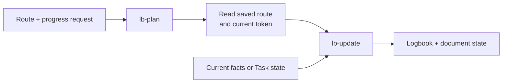
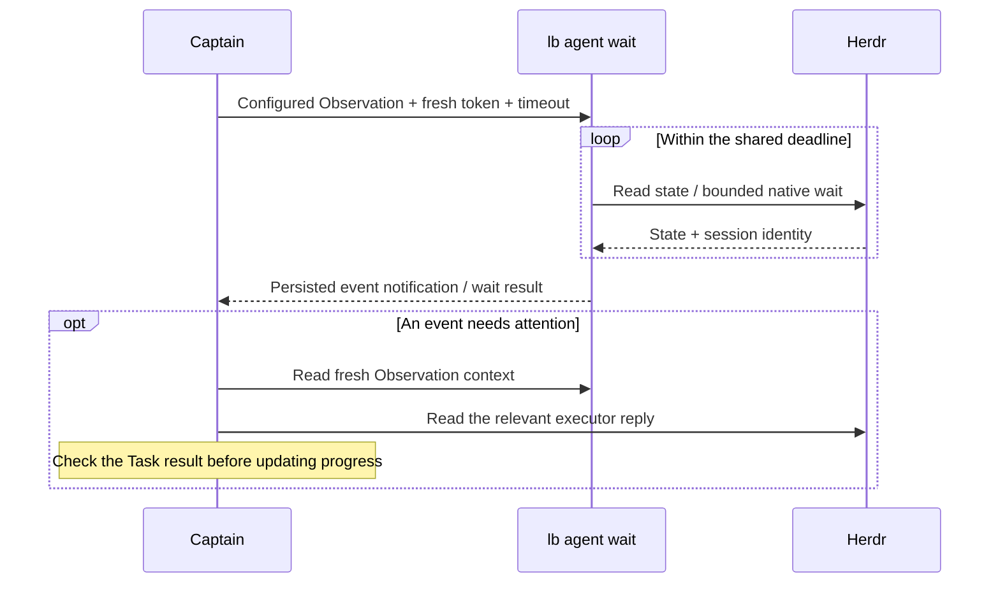

# lbkit

Reusable Logbook coordination skills, Markdown contracts, and the `lb` CLI for human–agent collaborative delivery. Current version: see [VERSION](VERSION) (`bin/lb --version`).

## Overview

**lbkit** is a shared kit that gets mounted as a `.lbkit` Git submodule in a consuming repository. It provides the coordination skills, document contracts, and CLI that let a human owner, a coordinator agent, and executor agents deliver real projects through a plain Markdown **logbook** — the single source of scheduling truth.

- **Admiral (human)** — owns goals, risk acceptance, and irreversible decisions
- **Captain (coordination agent)** — maintains goals/routes, dependencies, dispatch and progress; personally executes scoped difficult work through takeover
- **Sailors (execution agents)** — accept self-contained instructions, perform implementation, investigation, testing or review, and return observations without Logbook access

Captain checks completion against the agreed result and applicable executor evidence. Authorization boundaries and human checkpoints remain explicit: plans do not authorize execution, and agents cannot complete human-owned items. They can record when human review starts.

Tasks support direct completion, visible pause/resume and blockers without a compulsory Run or result form. Replacing a Task archives its history and updates explicitly mapped dependencies atomically. Herdr provides verified session open/close and bounded multi-target waiting; runtime idle, exit or message delivery never completes a Task.

## Install

Follow the [installation and upgrade guide](docs/guide/install.md). mind-forge is required.

## Skills

| Skill | Role |
|---|---|
| [lb-init](skills/lb-init/SKILL.md) | Install or refresh lbkit; maintain host configuration and reusable skill recipes |
| [lb-scaffold](skills/lb-scaffold/SKILL.md) | Create a workflow instance logbook for a real project |
| [lb-workflow](skills/lb-workflow/SKILL.md) | Create and refine reusable workflow templates without rewriting existing instances |
| [lb-plan](skills/lb-plan/SKILL.md) | Create or change the route: goals, Tasks, order, dependencies, planned responsibility, skills and acceptance criteria |
| [lb-preflight](skills/lb-preflight/SKILL.md) | Preview the concrete next step and record actual preparation, risks and gaps |
| [lb-push](skills/lb-push/SKILL.md) | Execute, delegate, wait, check results and continue within granted authorization |
| [lb-takeover](skills/lb-takeover/SKILL.md) | Captain personally resolves a scoped difficult problem |
| [lb-handback](skills/lb-handback/SKILL.md) | Return execution to Sailor with verified receipt |
| [lb-update](skills/lb-update/SKILL.md) | Record current facts, results and Task state while preserving the route; reread human edits without writing by default |
| [lb-status](skills/lb-status/SKILL.md) | Report current status without writes or cleanup |
| [lb-retro](skills/lb-retro/SKILL.md) | Consolidate cross-logbook lessons, feedback and skill adoption |

Only `lb-plan` changes the route. Pause/resume and actual blockers are state updates handled by `lb-update`; they do not authorize bypassing dependencies or reassigning work. A mixed request applies its authorized planning changes first, reads back the saved route, then updates progress against the current conditions. Existing explicit decisions need no repeated confirmation.



The planning branch applies when a request changes the route and updates progress together. A request only to reread human edits defaults to read-only alignment.

Status questions during authorized execution do not revoke that authorization: the caller answers read-only and continues. Explicit pause, blockers and human gates still govern advancement.

### Configuration and recipes

`lbkit.yaml` holds settings and launchable agents; `lbkit-skills.yaml` holds the
repository's work-type skill recipes, which may name skills from any source. Use
`lb config show/check/resolve`, `lb config agent`, and `lb config recipe`.
Registry writes change one object with an expected file version and a preview.
See the [configuration contract](docs/installable/configuration.md) for the model,
lifecycle and examples. Agent bindings remain runtime data;
actual skill usage belongs in Thinking.

## CLI

Run the CLI from the consuming repository root with `bin/lb`; it treats the current directory as the document root unless `--root` is supplied.

```sh
bin/lb log list                           # locate project logbooks
bin/lb log context LOG --json             # current document state and write token
bin/lb log check LOG                      # validate one logbook
bin/lb task list LOG                      # inspect Tasks, including paused work
bin/lb task next LOG                      # show the next scheduling candidate
bin/lb task show LOG TASK_ID              # inspect an identified Task
bin/lb config recipe list --status available
bin/lb config resolve --json
bin/lb config agent list
bin/lb skill extract                      # planned Task skill annotations
bin/lb skill history                      # authorized session skill observations
```

Register Task identities before using semantic lifecycle actions. For a completion already supported by the agreed criteria and evidence, preview the write with the current context token:

```sh
bin/lb task complete LOG TASK_ID --basis 'Applicable executor result checked' \
  --expect-version TOKEN --dry-run --json
```

Inspect the preview, then repeat without `--dry-run` and with the same token. Use the returned token for the next operation's own preview. `task pause/resume/block/unblock/cancel/reopen` update existing Task state; pausing a Task does not stop its executor. `task migrate` previews explicit legacy mappings, and `task split` requires reference mappings for identified replacements. See the [domain commands](docs/installable/domain-commands.md) and [CLI reference](docs/installable/lb-cli.md) for arguments and protections.

Document writes carry the SHA-256 `version_token` returned by `log context --json`; registry and execution records have their own tokens. CAS rejects concurrent changes. Runtime operations also verify their target identities and report partial outcomes; external effects are not a file transaction.

### Herdr waiting

Use managed Observation for durable event recovery. Read context first; configure
only when targets are absent or changed, after the existing listener has exited:

```sh
bin/lb agent observation context LOG --json
bin/lb agent observation configure LOG --input-file targets.json --expect-version TOKEN
bin/lb agent observation context LOG --json
bin/lb agent wait --log LOG --timeout 45 --expect-version FRESH_TOKEN
```

Replace LOG and token placeholders with the actual logbook and the version_token
from each preceding context read. targets.json contains `{"targets": [...]}` with
complete verified bindings. Claude Code prefers native Monitor running the wait
command with `--stream`; foreground wait is the fallback. Follow the
[Herdr workflow](skills/lb-push/references/herdr.md#wait-and-continue) for setup and
handling. Read fresh context on notification to recover unresolved Events and
pending Answers. Observations never complete business Tasks.

Legacy `bin/lb agent wait --input-file wait.json --timeout 45 --json` remains
read-only. Preserve its complete next_input, including unresolved_events; this raw
mode has no managed persistence or listener ownership guarantee.



The process waits between observations; the model handles the returned events. An observation may indicate a blocker or an identity gap, rather than a completed business result. See the [wait service](src/logbook_cli/services/agent_wait.py) and [observation reducer](src/logbook_cli/wait_state.py).

### Upgrading consumers

Consumers choose an exact submodule revision, then rerun the installer. From the consuming repository root:

```sh
git -C .lbkit status --short
git -C .lbkit fetch origin
git -C .lbkit switch --detach TARGET_REV
./.lbkit/bin/lbkit install --dry-run
./.lbkit/bin/lbkit install
./bin/lb --version
```

Resolve any local changes before switching; replace `TARGET_REV` with the chosen fetched commit or tag. Review and commit the `.lbkit` pointer change in the consuming repository to pin the upgrade. The [installer](bin/lbkit) refreshes locked dependencies, shared links and missing templates; it does not fetch newer code or overwrite existing host configuration.

Review the [Task migration contract](docs/installable/document-state.md#canonical-task-migration) before converting legacy records: current Task state comes from Markdown, and split originals move to a historical sidecar archive. Migration is explicit and CAS-protected; ambiguous legacy facts are refused. Keep consumer documents and their state files together when reviewing or rolling back a migration.

## Shared contracts (installed into consuming repositories)

Start at the [documentation index](docs/README.md) for user guides, contributor documentation and reference navigation. Only `docs/installable/` is distributed to consuming repositories, under their existing `docs/` paths.

- [Lifecycle & skill entries](docs/installable/lifecycle.md)
- [Coordination contracts](docs/installable/coordination.md)
- [Logbook format](docs/installable/logbook-format.md)
- [Configuration & runtime adapters](docs/installable/configuration.md)
- [`lb` CLI reference](docs/installable/lb-cli.md)

## lbkit development

Documentation for developing lbkit itself — not installed into consuming repositories:

- [Development guide](docs/dev/development.md)

The [core concepts](docs/guide/concept.md) explain Logbook → Stage → task, three roles and machine/session scheduling. Human-readable status stays in the briefing or existing CLI queries; writes create no TODO companion. Business originals/checks follow host rules, with no mandatory evidence/source index.
