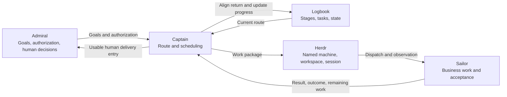

# Core concepts

[English](concept.md) | [简体中文](concept.zh-CN.md)

lbkit uses a **Logbook** to organize a human goal into an actionable task route.
**Admiral** owns goals and authorization, **Captain** designs with Admiral and maintains the
route, and **Sailor** performs business work and acceptance. **Herdr** provides
visible execution resources. Work can span machines while the Logbook retains
shared goals, responsibilities and progress.

## Logbook: a coordination ledger for one goal

A Logbook concerns a project or one workflow run. It answers what to achieve,
how to progress, who owns each result and where the work stands. It is a shared
Markdown document and the scheduling basis for this work. Captain recovers the
route from the current document rather than relying only on chat memory.

Its main structure is **Overview → Stage → task**:

| Concept | Meaning | Contents |
| --- | --- | --- |
| Overview | Overall goal and scope | Human-defined goal, scope, working directories and project-level entries |
| Stage | A group of meaningful results or handoffs along the route | Stage title, ordered tasks and relevant delivery entries |
| Task | One explicit responsibility and result | Action/result, owner, completion conditions, state and necessary delivery entry |

Goals come from Admiral. Captain may record explicitly supplied goals, propose
a route and maintain a confirmed plan. Stage titles and tasks express progression;
there is no need to generate a separate Stage goal awaiting human fill-in.

The Logbook retains enough state, dependencies, blockers and result entries to
coordinate. Concrete implementation steps, business prose, test output and
original material follow the responsible repository's conventions. A delivery
link helps the recipient locate a result; its existence does not prove acceptance.

With mind-forge, Prompt preserves intent/constraints and Thinking preserves
coordination decisions, recovery information and requested run metrics. Business
Article/Source records keep host-owned placement and bindings.

## Design before execution

During lb-plan, Captain personally discusses the approach with Admiral and writes
specs in one or more authorized project repositories. Use the host's spec-driven
workflow; Spec Kit is optional. A small task needs only a small design, and an
applicable existing spec can be reused. The spec explains the approach, tradeoffs,
constraints, responsibilities, interfaces, route and pending decisions. Captain
briefly summarizes it for Admiral before ordinary execution. Reading a reference
repository does not authorize writing it.

Repository specs own the design; Logbook owns scheduling. Thinking preserves
choices and confirmation references, and Sources may retain identified design
material under host rules. Preflight can examine an unfinished design, but green
preflight does not confirm it. Ordinary lb-push requires a settled core design,
Admiral confirmation and execution authorization. A real POC needs an explicit
todo, affected-route reorganization and renewed Admiral discussion. Its bounded
execution returns findings to design; it does not release the remaining work.

Sailor receives clear, verifiable work and chooses routine implementation details
within the agreed constraints. Choices affecting scope, interfaces or acceptance
return to Captain's planning. Changes are judged case by case.

Admiral may speak directly with Sailor through a dialogue window permitted and
opened by Captain. Captain recovers submitted content, decisions and open points,
updates applicable specs/Logbook/packages, and verifies the owning Sailor has the
current instructions before affected work resumes. Opening a window does not
complete that recovery or establish acceptance.

## Tasks: a deliverable responsibility with completion conditions

A task tells its owner what to deliver and how completion is determined. For
example, delivering a research report ready for the owner's review is a useful
result-level task. Research, writing, implementation, testing and acceptance can
all be tasks; separate them when delivery or responsibility requires it.

Tasks form an ordered route. Dependencies and human gates govern advancement.
An earlier Sailor return does not reorder tasks. Discovering independent work
does not itself authorize a new order or parallel launch.

| Marker | Meaning | Basis |
| --- | --- | --- |
| `[ ]` | Not started | No actual receipt or start of work |
| `[/]` | Received, not yet accepted | Working, blocked, in rework or awaiting an acceptance return |
| `[x]` | Completed under applicable conditions | Current Sailor result has an explicit applicable acceptance outcome; human items are completed by the human |
| `[-]` | Explicit skip/not-applicable record | Not an acceptance pass; cancellation or Stage closure needs its corresponding explicit disposition |

A session reporting `done`, a generated file or a bare completion claim cannot
alone support completion. The return identifies the current task/result,
acceptance outcome, delivery entry and remaining responsibilities.

A **work package** is Captain's assignment to Sailor: the task reference,
current inputs, authorized scope, expected result, completion conditions and
report-back method. One task may include several concrete operations. A package
may be a message or existing record, without a new file per dispatch. Captain
aligns the return before maintaining Logbook state.

A human task is an explicit human gate, such as reviewing a report or merging a
PR. Captain first prepares a usable entry. A delivered PR does not authorize its
merge; an opened review view does not complete review. Agents may record actual
human work starting but cannot complete, cancel or change the human gate.

## Roles: Admiral, Captain and Sailor

There are three roles. Admiral is human; Captain and Sailor are the two agent roles.

| Role | Responsibility | Typical actions |
| --- | --- | --- |
| Admiral (human owner) | Goals, authorization, major tradeoffs and agreed human gates | Supply goals, confirm a route, authorize advancement and make review/merge decisions |
| Captain (coordinating agent) | Design with Admiral, one Logbook's route and shared state | Write repository specs, maintain dependencies/owners, dispatch packages, observe progress, align returns and prepare handoffs |
| Sailor (executor agent) | Assigned business results and acceptance | Research, write, implement, test, review, perform acceptance and return outcomes/gaps |

Captain checks coordination facts: whether the return matches the current task
and result, whether its conclusion still applies, whether delivery is accessible
and whether the next step is authorized. Concrete content checks, business tests
and acceptance belong to Sailor. Missing/conflicting returns remain gaps and
are sent back to Sailor within execution authorization. A status/progress-only
request authorizes no new business execution.

Acceptance is a Sailor task type. Another Sailor may independently check a result
when required. There is no separate acceptance-agent role or compulsory checker
for every task.

Plan confirmation and execution authorization are distinct human decisions.
Existing authorization remains valid within scope, without repeat approval for
every routine step. Broader goals, machines, directories or operations still
require the relevant explicit authorization.

## Scheduling: Herdr and cross-machine collaboration

The Logbook defines the route, Captain makes scheduling decisions and Herdr
hosts sessions and visible execution state. Runtime observations do not decide
business completion; applicable Sailor returns and human gates do.

### Execution organization in Herdr

| Concept | Purpose | Relationship to lbkit |
| --- | --- | --- |
| workspace | Organize terminal resources for a project/collaboration scope | Contains the relevant Captain, Sailor and monitoring entries |
| tab / pane | Terminal tab and its splits | Locatable independent execution or observation positions |
| agent session | Continuing agent context and execution | Sailor receives packages, works and returns results; may be reused between tasks |

In the Herdr adapter, Captain's main tab and Sailor execution tabs are separate.
Local dispatch specifies the actual workspace identifier; execution tabs use
registered directories and independent visible monitoring. Background operations
target a specific session/tab/pane, without guessing from focus or stealing the
human's current window.

Reuse a Sailor session that still fits its next task. A task does not imply a new
session. Prepare another session when isolation, an independent check, approved
parallel work or context recovery actually needs it. Sessions, tasks and packages
are separate objects: closing a session does not accept a task.

The host's `lbkit-agents.yaml` declares the runtime adapter, allowed launchers and
collaboration parameters. Configuration selects tooling/parameters, not business
permissions. Herdr is the currently provided adapter. Other scheduling environments
need explicit host adapter capabilities; changing a launcher alone does not prove
dispatch, receipt confirmation and monitoring work.

### Cross-machine execution and handoff

Identify machines explicitly. Captain's machine, the control entry and Sailor's
execution machine may differ. Directories belong to named machines; an identical
path string on two machines does not identify one working copy. Machine identity
must not change with Captain's location or depend solely on relative local/remote
labels.

**Cross-machine execution** assigns a package to Sailor on another machine.
Captain retains the original Logbook, specifies the execution machine, approved
directory, current inputs and conditions, confirms actual receipt and observes
progress. Sailor works at that location and returns current result identity,
acceptance outcome and access entry. Dispatch does not add directory, publication
or push permissions.

**Cross-machine handoff** transfers coordination state and necessary results to
continue on the destination. Captain directly manages it within authorization:
compare revisions, uncommitted changes, reliable human rulings and open work at
both ends; perform permitted branch synchronization and retrieval; prepare a
workspace with the same name; confirm actual receipt by the receiving main
session. Matching workspace names can have different IDs on different machines;
the source ID is not automatically a destination locator.

Preserve both ends' uncommitted work and reliable decisions. An old destination
copy does not prove the source failed to complete work, and retrieving a new
result does not establish that an old conclusion fits changed inputs. Sailor
performs concrete rechecking. Admiral's authorization governs commits, pushes,
machines and directories; handoff implies no business production, publication
or environment upgrade.

### Sequence and parallel work

Captain evaluates opportunities on first route reading, after acceptance returns
and when waiting/blocked. Consider inputs/outputs, human rulings, owners, mutable
files and shared resources. Different repositories/worktrees alone do not prove
independence; Sailors sharing prose or a browser can still conflict.

Specify the batch, results/owners, input snapshot, isolation, convergence point
and authorization. Advance an approved batch; propose an unapproved one together
and continue unaffected authorized work. During human waiting, later work proceeds
only if independent of that decision, explicitly passable under the confirmed
plan and authorized for execution.

## How the concepts work together

For a research report, Admiral supplies the goal and authorization. Captain
maintains the material preparation, report delivery, agreed checks and human
review route in the Logbook. Captain uses Herdr to assign work packages to suitable
Sailors, potentially on another authorized machine.

Sailor delivers and returns outcomes. Captain aligns them, updates progress and
prepares the human review entry. Admiral decides; Captain then continues or
closes the route within authorization. The report, supporting material and
concrete checks remain in the host's existing document system; the Logbook shows
the current result and next responsibility.

