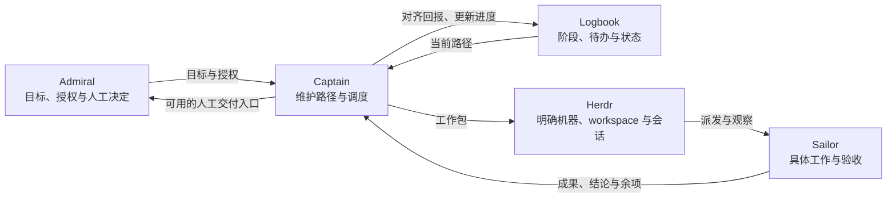

# 核心概念

[English](concept.md) | [简体中文](concept.zh-CN.md)

lbkit 用一份 **Logbook** 把人类目标组织成可推进的待办路径。
**Admiral** 决定目标和授权，**Captain** 维护路径并调度，**Sailor** 完成具体工作与验收。
**Herdr** 提供可见的执行环境；工作可以分布在不同机器上，目标、责任和进度仍由 Logbook 统一协调。

## Logbook：一个目标的协调账本

一份 Logbook 围绕一个项目或一次工作运行，回答四个问题：要达成什么、按什么路径推进、
每项成果由谁负责，以及当前走到了哪里。它是人和 agent 共享的 Markdown 文档，
也是这项工作的调度依据。Captain 需要从当前文档恢复路径，不能只凭聊天记忆安排下一步。

Logbook 的主要结构是 **Overview → Stage → 待办**：

| 概念 | 含义 | 保存的内容 |
| --- | --- | --- |
| Overview（总览） | 整项工作的目标与范围 | 人类确定的总目标、范围、工作目录和项目级入口 |
| Stage（阶段） | 路径中一组有意义的成果或交接 | 阶段标题、顺序待办和阶段使用的交付入口 |
| 待办 | 一项明确的责任与成果 | 要做什么、谁负责、完成条件、状态和必要的交付入口 |

目标来自 Admiral。Captain 可以记录明确提供的目标、提出路径建议，并维护已确认的计划。
Stage 用标题和待办表达推进关系，无需重复生成一个等待人类填写的阶段目标字段。

Logbook 保留足以协调的状态、依赖、阻塞和成果入口。具体实施步骤、业务正文、测试输出和原始资料
由负责的仓库按自己的约定管理。一个交付链接能让人找到成果，但链接存在本身不能证明成果已通过验收。

使用 mind-forge 管理文档时，Prompt 保留意图和约束，Thinking 保留协调决定、恢复信息和所需运行指标；
业务 Article、Source 等继续遵循宿主仓库的归属与绑定。

## 待办：可交付、可判断完成的一项责任

一项待办应让接手者知道要交付什么、由谁完成，以及按什么条件判断完成。
例如“交付可供负责人审阅的研究报告”比“运行某条命令”更适合作为成果任务。
研究、写作、实现、测试和验收都可以成为待办，是否独立列项取决于交付和责任边界。

待办在 Logbook 中排成路径。顺序表达推进关系，依赖和人工关口决定何时能够继续。
Sailor 回报得早，不会自动改变原来的任务顺序。发现可并行工作也不等于获准重排或启动批次。

| 标记 | 含义 | 如何判断 |
| --- | --- | --- |
| `[ ]` | 尚未开始 | 还没有实际接手或开始工作 |
| `[/]` | 已接手，尚未完成验收 | 正在执行、阻塞、返工或等待验收回报 |
| `[x]` | 已按适用条件完成 | Sailor 的当前成果有明确、适用的验收结论；人工项由人类完成 |
| `[-]` | 显式跳过或不适用记录 | 不表示验收通过；取消或阶段收口仍需对应的明确处置 |

Sailor 的会话显示 `done`、某个文件已经生成，或一条“已完成”的消息，都不能单独支持勾选。
回报需要对应当前任务与成果，并说明验收结论、交付入口和剩余责任。

**工作包**是 Captain 给 Sailor 的具体任务说明：对应哪项待办、当前输入、获准范围、预期成果、
完成条件和回报方式。一项待办可以包含多个具体操作；工作包可以是一条消息或已有记录，
不要求每次派发都新建文件。收到回报后，Captain 对齐任务和结果，再维护 Logbook 的状态。

人工待办是明确的人工关口，例如审阅报告或合并 PR。Captain 必须先准备好可用的入口；
交付 PR 不代表批准合并，打开审阅页也不代表人类完成审阅。
Agent 可以记录人工工作已开始，但不能代人类勾选完成、取消或改变这个关口。

## 角色：Admiral、Captain、Sailor

三个角色中，Admiral 是人类，Captain 和 Sailor 是两类 agent。

| 角色 | 负责什么 | 典型行为 |
| --- | --- | --- |
| Admiral（人类负责人） | 目标、授权、重大取舍和约定的人工关口 | 提供目标，确认路径，授权推进，审阅或作出合并决定 |
| Captain（协调 agent） | 一份 Logbook 的路径、调度与共享状态 | 维护依赖和负责人，派发工作包，观察进度，对齐回报，准备交接 |
| Sailor（执行 agent） | 工作包中的具体业务成果与验收 | 调研、写作、实现、测试、审查、验收，回报成果、结论与缺口 |

Captain 核对的是协调事实：回报是否对应当前任务与成果、结论是否仍适用、交付入口是否可用，
以及下一步是否在授权内。具体内容检查、业务测试和验收由 Sailor 执行。
回报缺失或矛盾时，Captain 明确缺口，并在执行授权内交回 Sailor 处理。
单纯查询或更新进度不授权新业务执行。

验收是 Sailor 承担的一种任务，需要独立检查时可以交给另一位 Sailor。
无需另设“验收 agent”角色，也不为每项工作强制增加一个检查者。

Admiral 确认计划与授权执行是两个不同决定。已经授予的授权在范围内持续有效，
Captain 不应为每个常规步骤反复索权；目标、机器、目录或操作范围扩大时，仍需相应的明确授权。

## 调度方案：Herdr 与跨机器协作

Logbook 决定工作路径，Captain 作出调度判断，Herdr 承载会话和可见的执行状态。
Herdr 的运行状态提供观察信息；业务完成与否仍取决于 Sailor 的适用回报和人工关口。

### Herdr 中的执行组织

| 概念 | 作用 | 与 lbkit 的关系 |
| --- | --- | --- |
| workspace | 按项目或协作范围组织终端资源 | 同一协调范围内放置 Captain、Sailor 和监控入口 |
| tab / pane | 终端标签及其中的分屏 | 提供独立、可定位的执行或观察位置 |
| agent 会话 | 一次持续的 agent 上下文与执行过程 | Sailor 在其中接收工作包、工作并回报；可在任务之间复用 |

在 Herdr 方案下，Captain 的主标签与 Sailor 的执行标签分开。
本机派发使用明确的 workspace 标识，执行标签使用已登记目录，并保持独立可见的监控。
后台操作明确指向目标会话、tab 或 pane，不靠当前焦点猜目标，也不抢占人类正在使用的窗口。

通常会复用仍适合当前任务的 Sailor 会话；待办不等于新会话。
需要隔离执行、独立检查、已批准并行或上下文恢复时，才按实际需要准备另一个会话。
运行中的会话、待办和工作包是不同对象，不能用关闭会话来代替任务验收。

执行环境由宿主 `lbkit-agents.yaml` 指定，包括 runtime adapter、允许的启动方式和协作参数。
配置选择工具和参数，不授予业务权限。Herdr 是当前提供的适配方案；其它调度环境需要明确的宿主适配能力，
不能只替换启动命令就假定派发、接收确认和监控都可用。

### 跨机器执行与跨机器交接

跨机器协作需要明确机器身份。Captain 所在机器、发出控制操作的位置和 Sailor 实际执行的机器可以不同。
目录属于某台明确的机器；同一个路径字符串在两台机器上不代表同一份工作。
机器身份不能随 Captain 的位置变化而改变，也不能只靠“本地”“远端”这样的相对称呼传递。

**跨机器执行**是把工作包交给另一台机器上的 Sailor。Captain 仍维护原来的 Logbook，
说明目标机器、已授权目录、当前输入和完成条件，确认 Sailor 实际接收了任务，并持续观察。
Sailor 在自己的执行位置完成业务工作，回报当前成果身份、验收结论与访问入口。
跨机器派发不会自动增加目录、发布或推送权限。

**跨机器交接（handoff）**是把继续工作所需的协调状态和必要成果移交到目标端。
Captain 在已有授权内直接管理这件事：比较两端版本、未提交改动、已知人工裁定和未完成责任，
完成获准的分支同步与目标端获取，准备名称一致的 workspace，并确认接收主会话实际拿到了交接内容。
同名 workspace 在不同机器上可以有不同标识，不能直接复用源端标识定位目标端资源。

交接必须保护两端未提交工作和可靠的人工决定。目标端旧副本不能证明源端尚未完成；
取回新成果也不能自动证明旧结论对变化后的输入仍然适用。具体复核由 Sailor 承担。
提交、推送、机器与目录范围以 Admiral 的授权为准，handoff 不默认包含业务生产、发布或环境升级。

### 顺序与并行

Captain 在首次读取路径、收到验收回报，以及遇到等待或阻塞时检查并行机会。
判断依据是输入输出、人工裁定依赖、负责人、可变文件和共享资源。
不同仓库或 worktree 不能证明独立；两个 Sailor 共写一份正文或共用浏览器时仍可能冲突。

发现机会后，Captain 明确批次、各包成果与负责人、输入快照、隔离方式、汇合点和授权状态。
已批准批次直接推进；未批准批次先集中提出建议，同时继续不受影响的已授权工作。
等待人类期间，也只有不依赖该裁定、按已确认计划允许越过、且获准执行的工作才能继续。

## 四个概念如何一起工作

以一份研究报告为例：Admiral 提供目标和授权，Captain 在 Logbook 中维护材料准备、
报告交付、约定检查和人工审阅的路径。Captain 通过 Herdr 把工作包交给适合的 Sailor；
Sailor 可以在另一台已获授权的机器上工作。

Sailor 交付并回报后，Captain 对齐当前任务与结果，更新进度，准备人工审阅入口。
Admiral 作出决定后，Captain 在授权内继续路径或收尾。
报告、支撑资料和具体检查记录留在宿主已有文档体系，Logbook 展示当前成果和下一项责任。

